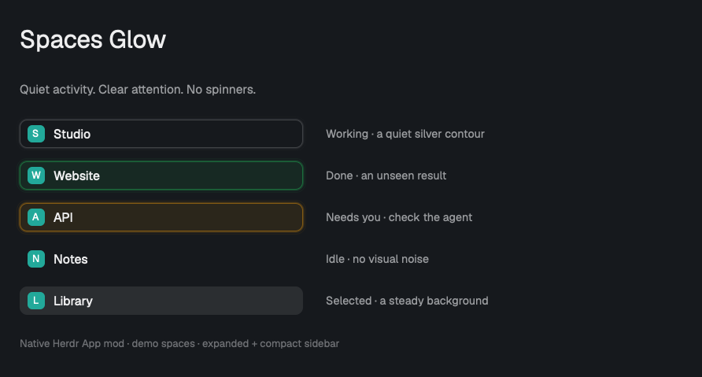
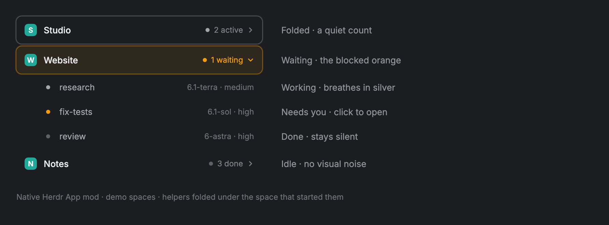

# Spaces Status

Agent status directly on your Herdr spaces. No separate Agents section needed for status monitoring.



- **Working:** a thin silver-gray contour gently breathes. No spinner or flashing fill.
- **Done:** a green glow marks an unseen response.
- **Blocked:** an orange glow means an agent needs you.
- **Idle:** no glow or animation.

Selection backgrounds stay still. Expanded and compact sidebars are supported; spaces with several agents can show working and attention signals together.

## Helpers

Helpers an agent starts with `hc run` fold under its space.



- **Folded** by default: `2 active`, `1 waiting` or `3 done` at the end of the row.
- **Unfolded:** one row per helper with its model and effort. A click opens its tab, or a peek if it has none.
- Working breathes in silver, waiting takes the blocked orange, done stays silent.

`bin/hc-tab <name> <folder> <command…>` starts a helper as its own tab in the caller's space. It stays the caller's child, so `hc wait --children` and `hc send` work as before.

## Install

Requires the **Herdr desktop app**, not the terminal-only `herdr` program. Checked with Herdr App **0.1.11** on macOS.

Ask your agent:

> Install https://github.com/filipores/herdr-spaces-status as a replacement for my Spaces sidebar. Read RECIPE.md and the code first. Preserve my layout, keybindings, and terminals; clone a shipped layout before changing it. Do not overwrite an existing mod with the same name.

For manual installation:

1. Read the [recipe](RECIPE.md), including its external-access disclosure and precautions.
2. Copy `mods/spaces-glow/` into your Herdr app home's `mods/` directory (default: `~/.config/herdr-app/mods/`). Stop if that name already exists.
3. In a **personal** layout, change the existing Spaces block's `content.mod` from `spaces` to `spaces-glow`. Keep its node ID as `sidebar`. Clone a shipped layout first; never edit Herdr's originals.
4. Run `herdr-app check ~/.config/herdr-app/mods/spaces-glow`, then check `herdr-app status` for errors. Adjust the path if your app home differs.
5. From this repository, run `node scripts/status-setup.mjs`. This mandatory, read-only preflight checks local and **every registered Herdr server**. Resolve or explicitly report each gap, then verify a real question/answer/cancel on each used host/client. See [host setup](integrations/README.md#required-host-setup). Installing the sidebar alone does not enable remote question reporting.

Copying the mod alone does not display it: `place: "none"` prevents a duplicate sidebar. The technical mod ID remains `spaces-glow` so existing layouts keep working. No layouts or keybindings are bundled.

**Undo:** set that block's `content.mod` back to `spaces`. Your terminals and other panels are untouched.

## Optional navigation keys

`spaces-glow.first_done` focuses the first done agent; `spaces-glow.next_working` selects the next space with a working agent, wrapping after the active space. With no match, nothing happens.

Suggestions only: merge these into your `keys.json` after checking for conflicts. The mod bundles no keybindings and must be shown in your layout to receive commands.

```json
{
  "global": {
    "ctrl-shift-f7": "spaces-glow.first_done",
    "ctrl-shift-f8": "spaces-glow.next_working"
  }
}
```

## Client integrations

The sidebar displays status reported by each client. The [host setup check](integrations/README.md#required-host-setup) is required; bridge installation remains opt-in. Pi bridges belong on the machine **running Pi**, not just the computer displaying Herdr. OpenCode setup is manual and version-gated; native Claude Code/Codex reporting needs no bridge.

## Checks

From the repository root, with Node **22.18+** and Herdr App installed:

```sh
node --experimental-vm-modules checks/spaces-glow.cjs
node --test checks/pi-question-status.test.mjs checks/status-setup.test.mjs
node --experimental-vm-modules --test checks/opencode-status.test.mjs
herdr-app check mods/spaces-glow
```

These cover glow/pulse rendering, navigation, safe drag-reordering, helper folding and routing, both bridges (including legacy Pi questionnaire events), and host discovery/safe setup regressions. Node checks also run in GitHub Actions. Interactive verification is described in the [integration guide](integrations/README.md#verification).

## Behavior and limits

- Git and machine reads use the original read-only commands, including on connected Herdr machines. Avatar colors and folded-machine preferences are stored locally. No analytics, credential handling or added package dependencies.
- Herdr changes `done` to `idle` once the response is seen; it signals an unseen response, not guaranteed task success.
- Re-sync this fork with the shipped Spaces mod after Herdr updates; icons and menus still come from the app.
- Light-mode inputs are tested; Light Mode, VoiceOver and system Reduce Motion have not been visually/accessibility tested. No documented Reduce Motion preference is exposed by the mod API.

## License

[Apache-2.0](LICENSE). Derived from [Herdr's Spaces mod](https://github.com/herdrdev/herdr-app/blob/v0.1.11/defaults/mods/spaces/main.js); see [NOTICE](NOTICE). Independent community mod, not an official Herdr release.
