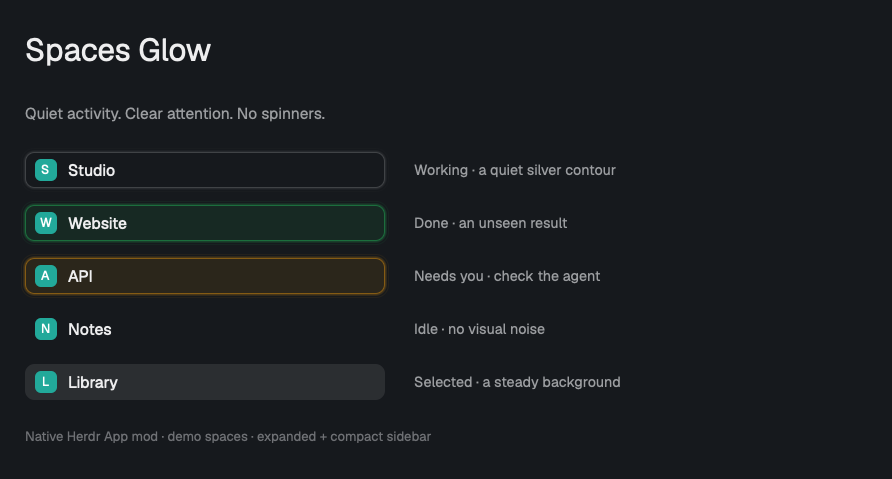

# Spaces Status

A replacement Spaces sidebar for the Herdr desktop app, with agent status directly on each space. It replaces the separate Agents section for status monitoring. Keep familiar project names, worktree nesting and Git hints; add green and orange attention glows and a quiet silver contour for ongoing work. Only the contour breathes: selected backgrounds and text remain still.

## What you see

- The usual **Spaces** heading and **+** control, followed by your spaces. Connected machines get collapsible headings when more than the local machine is present.
- Regular rows are 30 px high, nested worktree rows 28 px, with 8 px corners and horizontal padding. Names sit beside an 18 px colored initial or a worktree branch icon; repository, branch and ahead/behind hints appear at the right when useful. The base text size is 13 px.
- **Done:** a green `#22c55e` outline with a soft halo and a faint green fill.
- **Blocked:** the same treatment in orange `#f59e0b`.
- **Working:** a 1 px neutral contour using the theme's foreground color. It breathes between 10% and 24% opacity over 3200 ms with `ease-in-out`. Three outer contours, offset by 1, 2 and 3 px and weighted 0.38, 0.16 and 0.06 relative to the core, soften its edge. There is no working-state fill or spinner.
- **Idle or no agent:** no attention glow and no animation.
- The selected row retains Herdr's static selection background. Activity must not make several rows look selected.
- Below a sidebar width of 160 px, rows become a 26 px-high compact rail with an index and status mark. The same outline/glow behavior remains; the working mark is neutral.
- **Helpers:** a space whose agents have live helpers gets a fold control at the right end of its row: a 6 px dot, a label, a 10 px chevron; 20 px high, 5 px padding and corners, 11.5 px text. `N waiting` in `#f59e0b` when any helper is blocked or errored, else `N active` (theme `muted` dot) when any works, else `N done` (dim). Unfolded, each helper gets a 28 px row laid out like a worktree row (30 px inset, 13 px mark column, 9 px gap, 12.5 px `muted` text): a 6 px dot in the same colors and, at the right, model and effort in 11.5 px dim text (`6.1-terra · medium`). The compact rail shows no helpers.

## How it behaves

- Read the space's aggregate status for the attention glow. Herdr supplies priority `blocked > done > working > idle`; do not reimplement it.
- Independently collect spaces containing at least one `working` agent from `agents()`. A working agent in another space must never light up this row. Machine-qualified IDs must remain distinct.
- In mixed spaces, keep the working contour even when another agent is done or blocked. The stronger green/orange signal remains visible.
- Herdr's unseen `done` state returns to `idle` after the user looks at it. Do not keep your own completion latch, change agent state, or imply that completion means success.
- Animate only decorative outline elements. Keep the center transparent and leave the selected background, labels, avatars and row geometry static. Use native opacity animation, not a JavaScript timer, rotation, scaling or a moving highlight.
- A click selects a space; drag reorders spaces on their machine; right-click opens the normal space menu. The header **+** creates a space. Machine headers fold and remember their state. Compact rows retain click-to-select.
- Preserve the original Git hints, worktree nesting, avatar colors and local preferences. Bundle no keybindings.
- Optional commands: `spaces-glow.first_done` focuses the first done agent in `agents()` order; `spaces-glow.next_working` selects the next space with a working agent in `spaces()` order, wrapping after the active space. No match means no action. Suggested keys are in the README.
- Helpers are live terminals (`terminals()`, `state === "live"`) whose `parent` is an agent of the space (`agents()`, by `address`, grouped by `space`). Status comes from `agents()` when the helper has a pane, else from `terminals()`. Model and effort come from its `herdr.session-details` label (`model.id` without `gpt-`, `effort`); invalid or missing shows nothing.
- Working helper dots breathe: `opacity` 0.35 → 0.9 over 3200 ms, `ease-in-out`. Waiting and done are still.
- Every space starts folded. The control toggles it, stores open spaces in `localStorage` (`helpers.open`) and stops `mouse_down` propagation so it never selects or drags the row. A helper row runs `agent.focus` when the helper has a pane, else `terminal.peek` (`agent.focus` reports ok but shows nothing without a pane).
- `bin/hc-tab <name> <folder> <command…>` runs `hc run --bg --name <name> --cwd <folder> --label herdr.space=<caller's herdr.space> --label herdr.tab=<new id> -- <command…>`, then `tab.rename`, retried for up to 3 s because Herdr adopts the terminal asynchronously.

## Built from

- One mod: `mods/spaces-glow/main.js`, `navigation.js` and `mod.json`. The manifest is `place: "none"`; this replaces an existing Spaces block rather than automatically docking another panel. No `layouts/` folder or keys snippet is needed.
- The installation agent clones a shipped layout if necessary, then changes only the existing Spaces block's `content.mod` to `spaces-glow` in the user's personal layout. Keep the sidebar node's `id` as `sidebar` so its width can select regular or compact rendering.
- The implementation is a modified copy of Herdr App 0.1.11's `defaults/mods/spaces/main.js`, checked with Herdr App 0.1.11. Use `View`, `div` and `svg` from `gpui-kit`, plus `v_flex`/`h_flex` from `gpui-base`.
- Use `spaces()`, `agents()`, `terminals()`, `panes()`, `machines()`, `layout()`, `theme()` and `window()` for live data. Use `shared`/`setShared` for avatar colors and `localStorage` for folded machines.
- Native `.loop("opacity", {from: 0.1, to: 0.24, period: 3200, easing: "ease-in-out"})` belongs on a decorative, absolutely positioned container with a stable per-space ID. Its only children are thin, increasingly transparent outline layers.
- The colored attention treatment uses an inner fill with hex alpha `18` and four 1 px outlines with alpha `70`, `38`, `20`, `10`, offset outward by 0–3 px. The working contour is a separate lower layer; it never adds a fill.
- Use Herdr's installed `mods/workspace-chrome/` SVGs and the shipped `menu` mod. Do not bundle the app, generated type declarations or personal configuration.
- Preserve the original commands: `space.select`, `space.move`, `space.new`, plus the normal context-menu overlay. Receive optional navigation commands through `nextCommand()`; `navigationTarget` chooses `agent.focus` or `space.select` without side effects.
- **External access:** `exec` runs read-only `git status --porcelain=v2 --branch` (with optional locks disabled) and `git rev-parse` for each relevant repository, locally or on its Herdr machine. `watchFolder` watches local Git metadata. `hc machine ls --json` reads machine state. The inherited Git/machine refresh loops remain, but activity animation adds no polling. There is no analytics endpoint or credential access.

## Watch out

- This is for the native **Herdr App**, not the terminal-only Herdr configuration.
- **Host setup is mandatory:** run `node scripts/status-setup.mjs` from this repo before declaring installation complete. It checks local and all machines registered with `hc machine ls`; an unreachable host is an unresolved result, not a skipped success. Repeat after adding/reconnecting hosts or updating clients.
- Pi/OpenCode bridges are separate from the mod and belong on each machine running that client. See [host setup](integrations/README.md#required-host-setup). After explicit approval of each target, use `--install-pi HOST` for a missing compatible Pi bridge; never overwrite differing files or silently edit OpenCode config. The sidebar itself must not install extensions, infer questions or modify agent states.
- Never overwrite a user's existing mod, layout or keybindings. If `spaces-glow` already exists, stop or rename the new copy and its layout reference.
- Copying a `place: "none"` mod alone does not make it visible. Explicitly replace the existing Spaces block. Do not create a duplicate sidebar.
- A cloned layout still references its original mods. Point the Spaces block at the custom mod; leave every other block alone.
- Use the installed `AGENTS.md`, `herdr.d.ts` and `gpui-kit.d.ts` as API truth. The copies of these files generated by `herdr-app check` are not part of the distribution.
- Herdr replaces shipped mods at startup. This custom copy persists but does not automatically inherit upstream fixes.
- The neutral contour follows the foreground theme token; avoid hard-coded white that becomes invisible in Light Mode. Working must not reuse the selected background or turn into a full-row opacity pulse.
- State aggregation includes agents not represented by a visible pane. Read `agents()`, not only `panes()` or the aggregate space status, to find ongoing work.
- Light Mode, VoiceOver and system Reduce Motion have not been visually/accessibility tested. There is no documented Reduce Motion preference in this mod API; do not claim support that has not been verified.
- Machine folding is stored under the mod's own local-storage namespace; a new installation may start unfolded.
- The screenshot contains synthetic names/statuses and a frozen moment of the native contour animation. It is not a full-window screenshot of someone's terminals.
- A helper started without `herdr.space`/`herdr.tab` labels has no pane and can only be peeked at. Finished helpers stay listed until their process ends (`hc kill`).
- `grouped()` returns `[row, ...helperRows]` per space via `flatMap`; keep `open` a class field so a view without `init()` still renders. `bin/hc-tab` needs `HC_TERMINAL_ID`, `hc`, `herdr-app` and `python3`.

## Done when

- `herdr-app check mods/spaces-glow` passes with a compatible installed Herdr App.
- The host setup report lists every registered host. Missing, conflicting, unsupported and unreachable results are resolved or clearly handed off as incomplete. A matched file is not proof the extension is loaded: existing Pi sessions need `/reload`, and each used host/client needs a real question → orange → answer/cancel → no stuck orange check. Do not interrupt a live task to run it; get permission or report it pending. Native Claude Code/Codex and project/custom profiles also need this runtime check.
- `node --experimental-vm-modules checks/spaces-glow.cjs` passes navigation, glow/pulse, drag/drop and helper checks: no cross-machine move or move without hovering the target.
- An agent runs `bin/hc-tab demo . sleep 30`: a `demo` tab appears in its space without taking focus, the space shows a fold with `1`, and the tab closes when `sleep` exits. Unfolded, a click on `demo` shows its tab.
- Working-only rows show a thin neutral, softly breathing contour with no spinner and no animated fill. The same holds in compact mode and while selected.
- Done is green; blocked is orange; idle/no-agent has neither effect. Working mixed with done or blocked retains both signals. Another space's workers do not leak into this row.
- Across several native screenshots, outline pixels change but the row center and selected background stay constant. There are no layout shifts or native render errors.
- Normal selection, creation, reordering, context menus, machine folding and worktree/Git display still work as in the original Spaces mod.
- The user's other panels, layouts, keys and live terminals are untouched. Restoring `content.mod` to `spaces` removes the customization.
